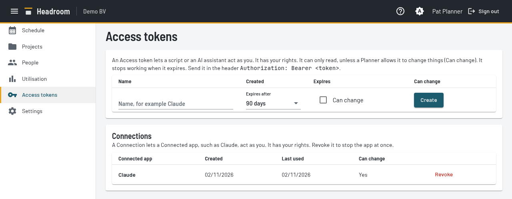

# Account page

The Account page holds your own login settings: your Passkeys, your Access tokens and your Connections.

## Passkeys

A Passkey lets you log in without waiting for a Login code. Your device or password manager keeps the Passkey.
The Login code always keeps working. Use it to log in the first time, on a new device, or after you lose a Passkey.

- To save a Passkey, select **Save a Passkey** and follow the prompt of your browser or password manager.
  The button shows only when your browser supports Passkeys.
- Headroom names the Passkey from your browser and system, for example "Firefox on Linux". You cannot rename it.
  The list shows the name, the creation date and the date you last used the Passkey.
- You can save several Passkeys, for example one for your laptop and one for your phone.
- To log in with a Passkey, open the login screen. Select **Log in with a Passkey**.
  Your browser can also offer the Passkey when you select the **Email** field. Choose it there.
  You do not enter an email address first.
- **Remove** deletes one Passkey at once. The device of that Passkey can no longer log in. Your other Passkeys keep working.
- You see only your own Passkeys on this page.
- A Person who has left cannot log in with a Passkey. When a Planner erases your personal details, Headroom deletes your Passkeys.
- A Passkey belongs to the domain of your Instance. If your Operator changes the domain, all Passkeys stop working. Log in with a Login code and save a new Passkey.

## Access tokens

An Access token lets a script or an AI assistant call Headroom for you.
The token belongs to you and has your rights, and no more.
A Person who is not a Planner reads what they can read in the app.
A Planner's token also reads the People list.
A token is read only by default. A read-only token cannot change anything.
Every Person can allow a token to change things with **Can change**.

- Enter a name, choose when the token expires, and select **Create**. Headroom shows the token once. Copy it at once.
  Headroom keeps only a hash, so it cannot show the token again.
  **Create** stays disabled until you enter a name.
- **Can change** is off by default. With it, the token changes data through the REST API and the MCP write tools, with the rights of its Person.
  A Person who is not a Planner can change only their own Time off. A Planner can also change Allocations and the rest of the planning.
  Headroom records each change for that Person. The rights follow the Person: a Planner who loses the role keeps the token, but it changes only their own Time off.
  A read-only token gets the answer 403 on every change.
- The choices are 30 days, 90 days, 1 year and Never. The default is 90 days. You cannot change the choice later.
- The list shows the expiry date of each token. A token that expires within 7 days has the mark "Expires soon".
- An expired token stops working and gets the answer 401. It stays in the list and shows "Expired".
  Revoke it to remove it. Headroom does not renew or delete tokens by itself. To get a new token, create one.
- Send the token in the header `Authorization: Bearer <token>`.
- **Revoke** stops one token at once. The other tokens keep working.
- You see only your own tokens on this page. A Planner sees all tokens on the [Settings page](settings.md).
- A token stops working when its Person has left, or when a Planner erases the personal details of the Person.
- A token cannot create, list or revoke Access tokens. Use the page for that.

## Connections

A Connection lets a Connected app, such as Claude, act as you.
You make a Connection when you allow the app on its consent screen. The Connection has your rights, and no more.
It is not an Access token. Use an Access token only for a client that cannot use a Connected app.

- The list shows each Connection with the Connected app, **Can change**, the date it was created and **Last used**.
  **Last used** is the date of the newest token of the Connection. A Connection that no one used yet shows "Never".
- **Can change** shows whether you allowed the app to change the planning. Every Person can allow it. The app then has the rights of that Person.
- **Revoke** stops one Connection at once. The app must ask you to connect again. Your other Connections keep working.
- You see only your own Connections on this page. A Planner sees all Connections on the [Settings page](settings.md).
- A Connection stops working when its Person has left, or when a Planner erases the personal details of the Person.
