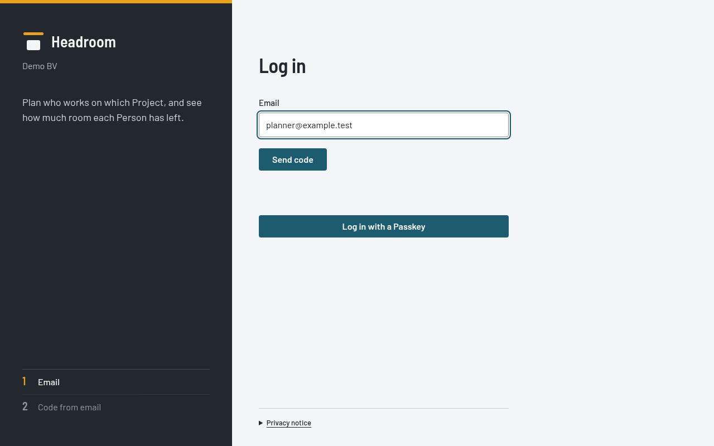
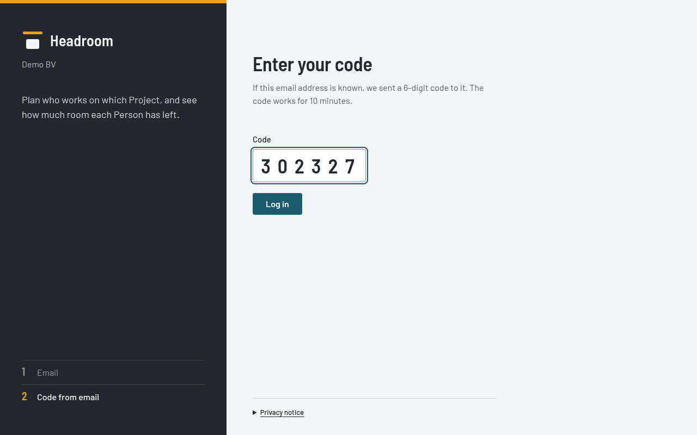

# Getting started

## Roles

- A **Planner** changes everything in the app.
- A **Person who is not a Planner** views the Schedule view, the Time off calendar, the Projects page and the Utilisation report.
  They change only their own Time off and their own Account page.

The server checks every right. A hidden button is not the only protection.
A disabled button says why in its tooltip.

## License

Headroom uses the MIT license. The file `LICENSE` in the repository has the terms.
It comes with no warranty. Support is best effort.

## General rules

- All dates use the Belgian format `dd/mm/yyyy`. Weeks start on Monday. The language is English.
- The time zone is Europe/Brussels. It is fixed. It defines "today" in every rule.
- Public holidays are Belgian public holidays.
- If two Planners change the same record, the last change wins. Headroom does not check for conflicts.
- Each record keeps who changed it last, and when.
- The app can be slow on the first request after a quiet period. Wait a few seconds.

## Log in

1. Open the URL of your Instance. The login screen opens.
2. Enter your email address. This is the email that a Planner entered for you on the People page.
3. Select **Send code**. Headroom sends a login code to that email.

4. Enter the 6-digit code. Select **Log in**.

You are logged in. The session lasts 30 days from your last visit.

After a login with a code, Headroom offers "Log in faster next time." Select **Save a Passkey** to save one, or close the message.
The offer shows only when your browser supports Passkeys. See the [Account page](account.md).

If you saved a Passkey, you can log in with it instead: select **Log in with a Passkey**. See the [Account page](account.md).

Rules for the code:

- The code works for 10 minutes and works once.
- You get 5 attempts for each code.
- You get 3 codes for each email in 15 minutes. After that, wait 15 minutes.

You get the same "code sent" message if your email is not known, or if your end date has passed.
In that case no email goes out. Ask a Planner to check your email address and end date.
Your login stops the day after your end date.

The login screen has a "Privacy notice" link. Click it to show the notice below the link. It names the company that controls your data.
It says what Headroom stores: your name, email, Contracts, Allocations and Time off.
Headroom erases your personal details 12 months after your end date.
The database host of your company sets how long backups keep data.

To log out, select **Sign out** in the header.

## The app

- The menu button at the left of the header shows or hides the side drawer.
- The header shows the app name, the company name, the help button, the theme button, your name and **Sign out**.
- The help button (**?**) opens the help for the screen you are on. On other screens, it opens the contents.
  A help topic has a "Back to Help" link to the contents. Each help page shows the app version at the bottom.
- The theme button cycles through Auto, Light and Dark. Auto follows your system.
- The side drawer has **Schedule**, **Time off**, **Projects**, **Utilisation** and **Account**, and for Planners also **People** and **Settings**.

## Planners: first steps

The Operator creates the first Planner on the first-run screen. The operator guide describes it.
That Planner gets a Contract of 8 hours, Monday to Friday, from the day of the first run.
Then follow these steps in order to set up the new Instance.

1. Set the Company days off. Open the **Settings** page.
   Add each Company day off for the year. See [Settings page](settings.md).
2. Add the People with their Contracts. Open the **People** page and select **+ Person**.
   Enter the first Contract in the same dialog. See [People page](people.md).
3. Add the Clients and Projects. Open the **Projects** page.
   Select **+ Client**, then select **+** on the Client group to add a Project. See [Projects page](projects.md).
4. Make the first Allocation. Open the **Schedule** view.
   Select **+ Project** on a Person and choose a Project. See [Schedule view](schedule.md).
