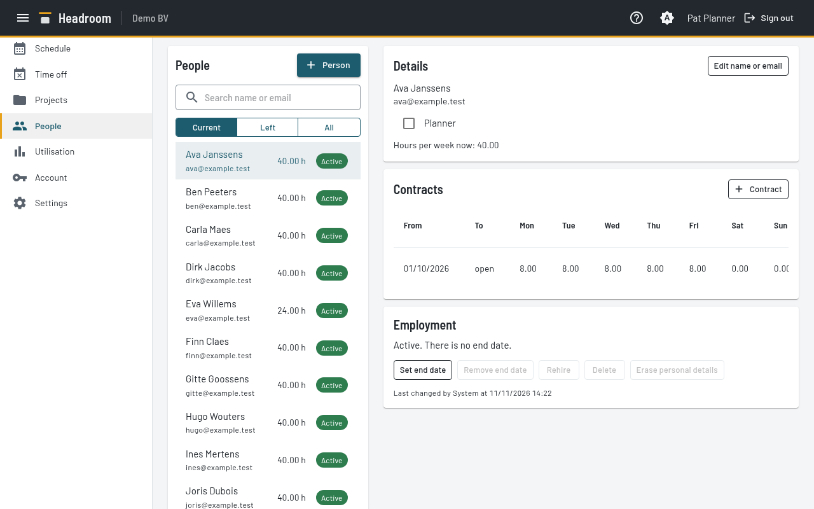
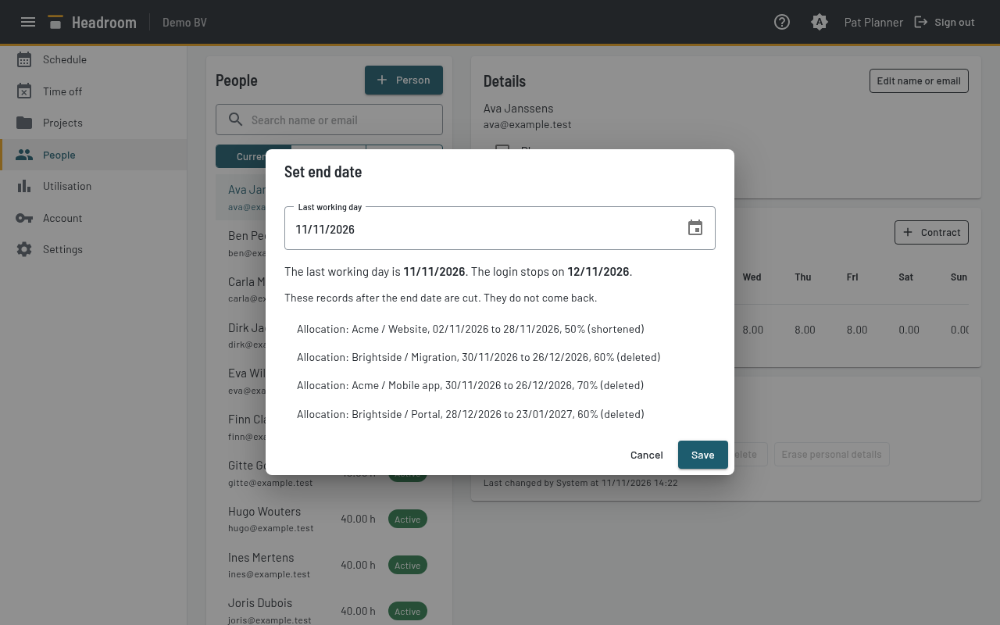

# People page (Planners only)

The server refuses this page for a Person who is not a Planner.

The list is on the left: name, email, hours each week and a status badge.
The detail panel for the selected Person is on the right.

- Search finds a name or email.
- The filter **Current** (the default) shows Active, Starts later and Leaving.
  **Left** shows Left and Erased. **All** shows everyone.
- Erased People show as "Former Person N".

Status values:

| Status | Meaning |
| --- | --- |
| Active | Has a Contract now, and no end date in the past |
| Starts later | The first Contract starts after today |
| Leaving | The end date is today or later |
| Left | The end date is before today |
| Erased | Personal details are removed |

## Add a Person

1. Select **+ Person**.
2. Enter the name and email. The email is the login and must be unique.
   **Add Person** stays disabled until the name, a valid email and the start date are filled in.
3. Tick **Planner** if the Person must be a Planner.
4. Enter the first Contract: the start date (default today) and the hours from Monday to Sunday.
   The default is 8 hours, Monday to Friday. Presets: 8 h Monday to Friday, 4 days, half time, 0 h.

## Details card

- **Edit name or email** changes the name or email.
- The Planner checkbox gives or removes the Planner right. Any Planner can do this, also for themselves.
- The last Planner who can log in cannot lose the flag, get an end date, be erased or be deleted. Make another Person a Planner first.
- The card shows the hours that apply now.

## Contracts card

- The table shows From, To, the hours from Monday to Sunday, and the hours each week.
- The **Edit Contract** and **Delete Contract** icons change a row. **+ Contract** adds a Contract from a date.
- You can change Contracts in the past.
- Two Contracts of one Person cannot start on the same day.
- A Contract cannot start after the end date. Use Rehire for that.
- A Person always keeps at least one Contract.

## Employment card

The card explains the status in a sentence. It shows the last change and who made it. It has these buttons:

- **Set end date** or **Change end date**. A dialog shows the last working day, the day the login stops,
  and the records that Headroom cuts:
  Allocations, Time off and Contracts after the end date.
  Allocations and Time off are deleted or shortened. Contracts that start after the end date are deleted.
  This also applies to Allocations of Archived Projects.
  Records that an earlier end date cut do not come back.
  You cannot set an end date before the first Contract. Delete the Person instead.

  

- **Remove end date.** Possible while the end date is today or later. After that, use Rehire.
- **Rehire.** For a Person who has left and is not erased. The dialog asks for a return date and Contract hours.
  Headroom adds a Contract with 0 hours for the gap, adds the new Contract from the return date,
  and clears the end date. This works for employees and freelancers.
  A freelancer between engagements has an end date, so they cannot log in. Capacity is 0 in the gap.
- **Erase personal details.** Removes the name and email. It also deletes the Connections of the Person.
  Contracts, Time off and Allocations stay, under the name "Former Person N".
  It also blanks the name and email inside stored Webhook Events.
  The result is not anonymous: colleagues can still tell who it was. You cannot undo it.
  The Person loses the Planner flag and cannot be rehired. A return creates a new Person.
  Headroom also does this by itself 12 months after the end date.
  A Planner can do it earlier when the end date is today or earlier.
  Tick "I understand" in the dialog.
- **Delete.** Possible only when no Allocation, no Time off and no "last changed by" refers to the Person.
  In all other cases, set an end date.

