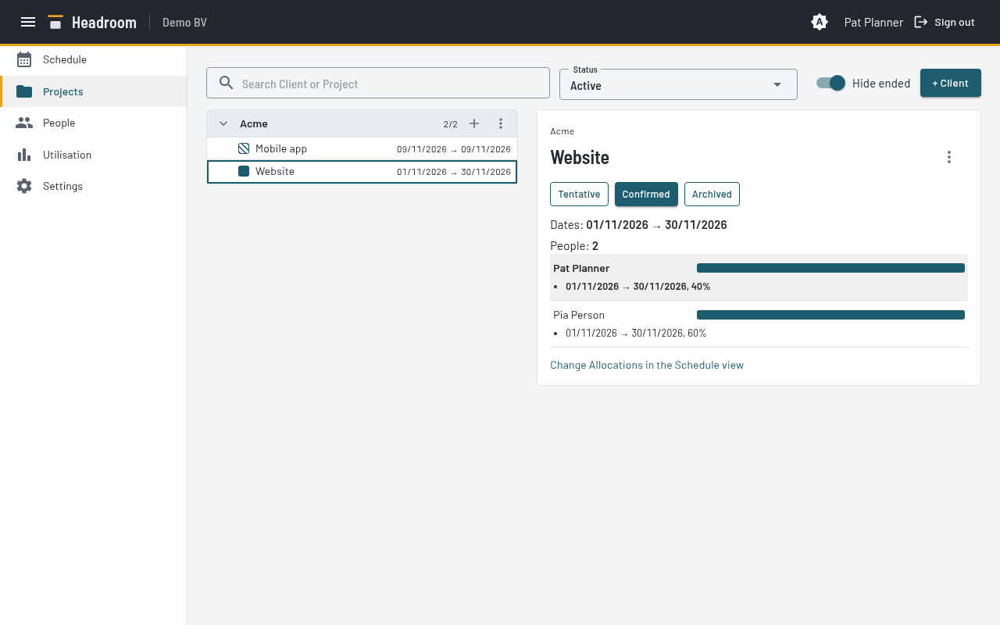

# Projects page

The page lists Clients with their Projects on the left. The detail panel for the selected Project is on the right.

- Each Project row shows a status swatch, the name and its dates (first to last Allocation).
- A Client group collapses. A search match opens its group.
- Search finds a Client or a Project name.
- The **Status** filter: Active (Tentative and Confirmed, the default), Tentative, Confirmed, Archived, All.
- **Hide ended** is on by default. An ended Project is a Project whose last Allocation is before today.
- The detail panel shows the Client, the Project name, the status, the dates, the number of People,
  and each Person with their Allocations and a small timeline.
  A link opens the Schedule view.

Allocations are read-only here. Planners change Allocations only in the Schedule view.

People who are not Planners see the same page, read-only.
They also get **Only my Projects**, and their own row is highlighted.

## Planners: manage Clients and Projects

- **+ Client** adds a Client. A Client has only a name.
- **+** on a Client group adds a Project for that Client. Give the name and a status, Tentative or Confirmed.
- The status control sets Tentative, Confirmed or Archived.
  An Archived Project shows **Unarchive**, which sets it to Confirmed.
- The menu of a Project has **Rename**, **Move to another Client** and **Delete**.
  In **Move to another Client**, type in the **Client** field to search the Clients.
  Delete also deletes the Allocations of the Project. A dialog shows how many.
- The menu of a Client has **Rename** and **Delete**. You can delete a Client only when it has no Projects.
- Names stay unique. A Client whose Projects are all Archived is not in the pickers.

