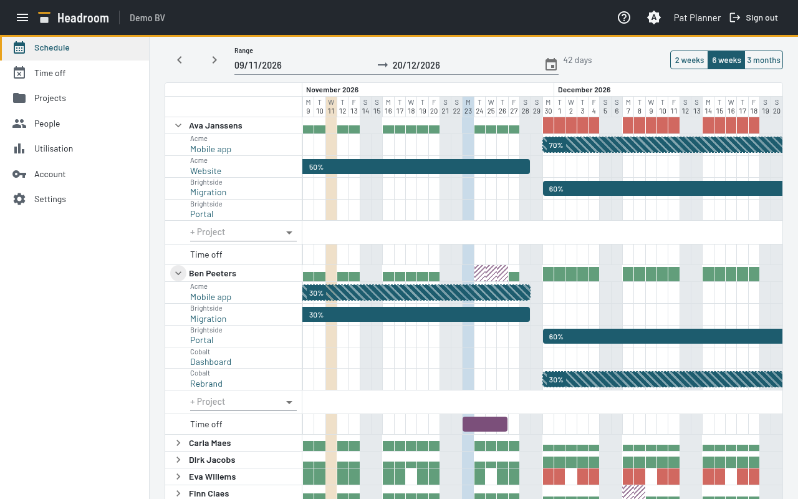
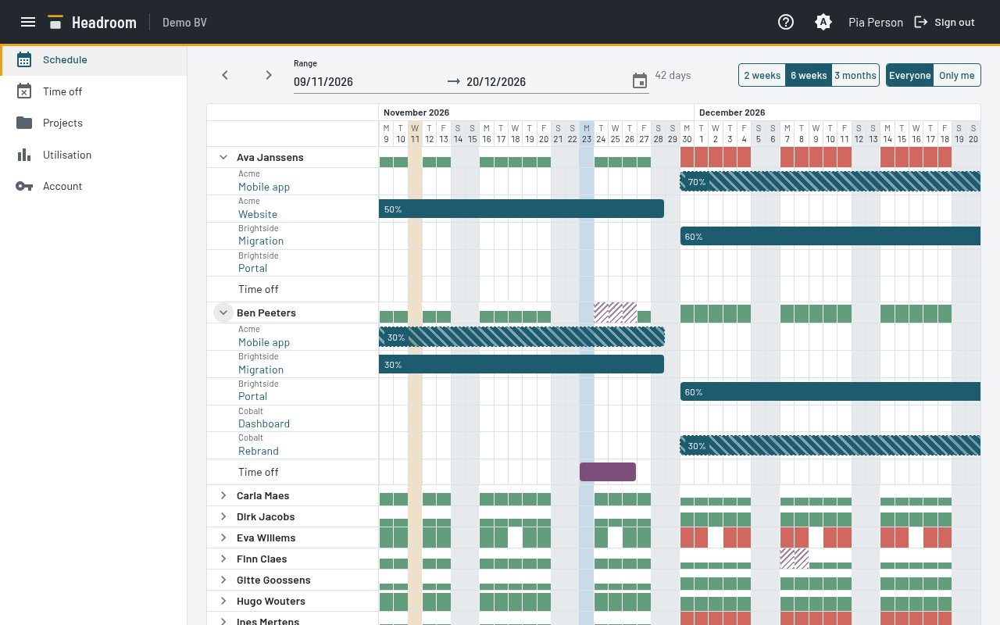
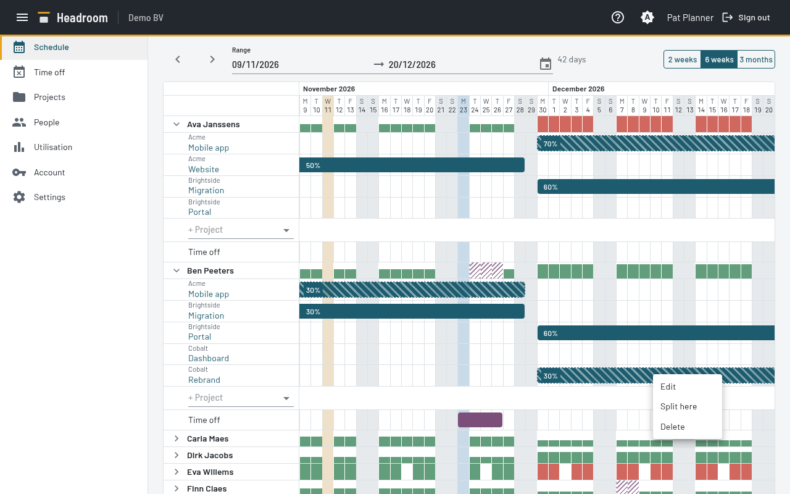

# Schedule view

The Schedule view is the main screen.

## Read it

- Each Person is a group. The group row is low. It shows the daily Utilisation as a bar that fills the whole day:
  allocated hours divided by Capacity. The bar is red above 100%. A day with no Capacity shows a gap.
  Time off on a working day is hatched in the group row.
- Expand a Person to see one row for each Project, and one row for Time off.
  The row label shows the Client above the Project name.
- Colours: Confirmed, Tentative (also hatched) and Time off. Archived Allocations use the Confirmed colour.
  Public holidays and Company days off are shaded behind the rows.
- A Person shows when a Contract with hours, an Allocation or Time off falls in the range.
- Select a Project name to open it on the Projects page.

## Move around

- Pick the days with the date range picker. Type the dates or select them in the calendar.
  The whole range fits the width. A day box is at least 8 px wide.
  Above 45 days, the day header shows only the day number.
- Select **2 weeks**, **6 weeks** or **3 months** in the toggle group to set the length. The first day stays.
  The toggle group marks the preset that equals the shown range.
  **3 months** ends one day before the same date 3 months later. From 1 November, it ends on 31 January.
- The default is 6 weeks, from the Monday of this week.
- The range is at most 3 calendar months from its first day.
  If the range is longer, or the end is before the start, Headroom keeps the old range and shows a message.
- Select the arrows to move the range back or forward by its own number of days.
- Scroll sideways to see other days. The range moves with the scroll and keeps its number of days.
  The picker shows the visible days. Headroom loads more days when you come near an end.
- A month row above the days shows one cell for each month. The name stays at the left edge while its month is in view.
  A month with fewer than 4 visible days shows a short name.

## People who are not Planners

You see the same view. You cannot change Allocations, and you cannot change the Time off of other People.
You can add, change and delete your own Time off. See "Change Time off".
Your own group is highlighted.
Use the toggle group to select **Only me** (only your group) or **Everyone** (all groups).

## Planners: create

- **Allocation.** Select **+ Project** on a Person and choose a Project.
  This adds a row. Type in the field to search the Projects. Archived Projects are not in the list.
  Select the first day, then the last day. A dialog opens with these dates and 50%.
  Change the percentage or other fields, then select **Save**. **Cancel** creates nothing.
  The dialog has one **Period** field. To pick a single day, select the same date twice.
  Type in **Project** or **Person** to search. An empty field shows all choices.
- **Time off.** A Planner does this on every Person. Other People do it on their own row. Select the first day, then the last day, on the **Time off** row.
  The Time off is created at once, without a dialog.

Start on an empty day. A click on a bar does not start a new Allocation.
The last day may be on a bar: the new Allocation then replaces those days of the old one.
Press Escape to cancel after the first day.
After the first day, move the pointer near the left or right side of the days to scroll the grid.
This does not work over the names.

## Planners: change an Allocation

- Select the percentage to change it, in steps of 5%.
- Drag the bar to move it. Drag an edge to make it longer or shorter.
  Hold the pointer near the left or right side of the grid to scroll while you drag.
  The grid scrolls at a fixed speed per second.
- Open the bar menu: right-click the bar, or focus it with Tab and press the Menu key or Shift+F10:
  - **Edit** opens a form: period, percentage, Project and Person.
  - **Split here** splits the Allocation into two.
  - **Delete** deletes it.

  

- An Allocation of an Archived Project is read-only. It has no percentage control, no drag and no menu.

For one Person and Project, only one Allocation covers a day.
Over-allocation is allowed. Headroom shows it and does not block it.

## Change Time off

A Planner changes the Time off of every Person. Other People change only their own.

- Drag and resize a Time off bar like an Allocation.
- A **½** at the start or end of a Time off bar marks a half day.
- Open the bar menu: right-click the bar, or focus it with Tab and press the Menu key or Shift+F10. It has **Edit** and **Delete**.
  **Edit** has one **Period** field. To pick a single day, select the same date twice.
  **From part** and **To part** each have the choices **Morning** and **Afternoon**.
- The menu also lets you set the first day and the last day to half day or full day.
  For a single day, choose **Morning**, **Afternoon** or **Full day**.

Time off has no type. Leave, sickness and other absence are all the same.

