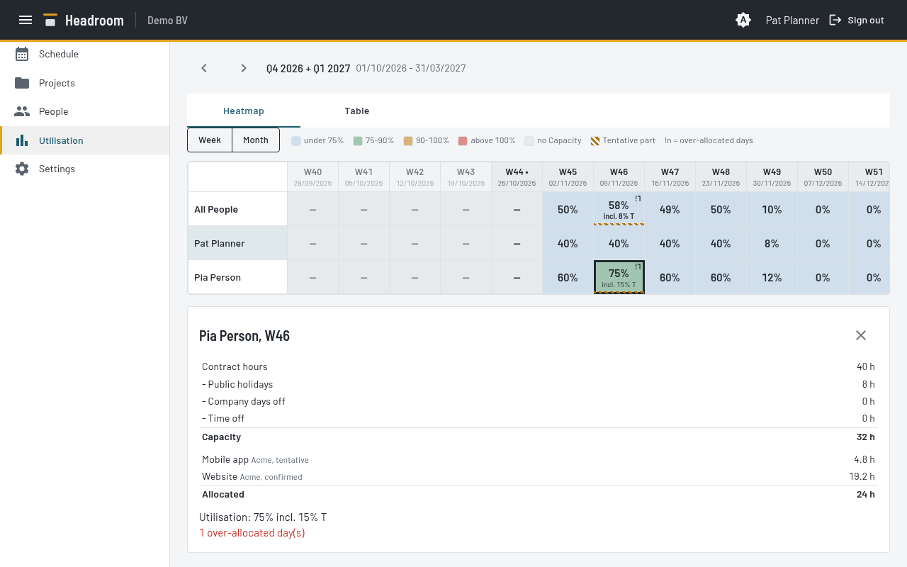
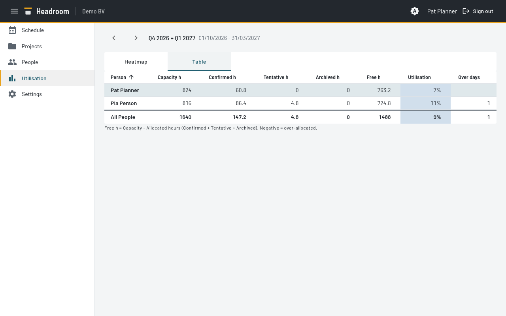

# Utilisation report

Utilisation is allocated hours divided by Capacity.
Allocated hours include Confirmed, Tentative and Archived Allocations.
Everyone sees the whole report, read-only. Your own row is highlighted.

- The range is the current quarter and the next quarter.
  Select the arrows to go back and forward by one quarter.
  Past periods are faded. The current period is marked.

## Heatmap tab

- People are rows. Periods are columns. The first row is **All People**. The last column is the whole range.
- Use the toggle group to select **Week** (the default) or **Month**.
- Select a cell for a breakdown: contract hours, public holidays, Company days off, Time off, Capacity,
  and hours for each Project.
- A hatched strip and "incl. x% T" show the Tentative part of a cell.
- A cell with over-allocated days shows "!n".
- A period with no Capacity shows "—", not 0%.

| Utilisation | Meaning |
| --- | --- |
| Below 75% | Under-used |
| 75% to 90% | Ideal (green) |
| 90% to 100% | High (amber) |
| Above 100% | Over-allocated (red) |
| No Capacity | Grey |

**All People** is the sum of allocated hours divided by the sum of Capacity.

## Table tab

The table shows totals for the whole range: Capacity, Confirmed, Tentative, Archived and Free hours,
Utilisation, and the days of over-allocation. Select a column heading to sort. The header row stays in view while you scroll the table.
The **Week** and **Month** toggle group shows only on the Heatmap tab.

A Person who is erased shows as "Former Person N" in periods before the end date.

